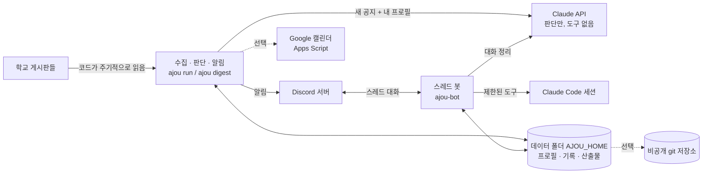

# ajou-notice-assistant

**English summary.** A self-hosted assistant that polls university notice boards (Ajou University's public boards by default, any CMS-style board via a JSON file), asks Claude whether each new notice matters to *you* given a profile you write, and sends only what matters to your own Discord server in four notification tiers. Fetching and scheduling are plain code; the model is called only to judge newly collected notices and to summarize your chat threads. Notice text is treated as untrusted input: the judging call has no tools and returns schema-checked JSON, and the thread bot runs with a restricted tool set. All personal data (profile, records, IDs, secrets) lives outside this repository. Runs as a Docker image (`ghcr.io/minhowow/ajou-notice-assistant`) or with uv. Korean documentation below. License: MIT.

학교 공지를 모아 내 상황과 대조하고, 필요한 것만 내 Discord 서버로 알립니다. Discord 스레드에서 이어서 대화하면 Claude Code가 지원서 초안 같은 작업을 돕고, 대화에서 나온 결정·사실·할 일·일정은 기록으로 남습니다.

기본 수집처는 아주대학교 공개 게시판입니다. 게시판 목록은 설정 파일로 바꿀 수 있고, 마크업이 다른 사이트는 파서를 추가하면 됩니다.

> 상태: 한 학생이 집 서버에서 매일 쓰는 코드를, 설정만 바꿔 누구나 쓸 수 있게 정리한 것입니다. 작성자도 이 저장소의 도커 이미지를 그대로 받아 씁니다(0.3.0부터). 실제 Discord·Claude·Apps Script에 연결하는 단계는 처음 설정할 때 직접 확인해야 합니다.

할 수 있는 것:

- **공지 판단과 알림**: 새 글을 프로필과 대조해 관련도·자격·마감·할 일을 뽑고, 네 단계 알림으로 보낸다. 교수 추천서처럼 남에게 부탁할 서류는 준비 기간을 거꾸로 세어 "부탁 시작"을 알린다.
- **재공지 묶기**: 같은 공지가 다른 게시판이나 [재공지]로 다시 올라오면 처음 공지에 묶어 알림·독촉·캘린더를 한 번만 한다. 바뀐 점이 있으면 한 줄로, 스레드가 있으면 스레드에 알린다(`repost.py`).
- **마감 독촉**: D-3·D-1·당일. 완료·패스 버튼이나 `ajou mark`로 끄고, 알림의 📌 핀 버튼(또는 Discord 고정, `ajou mark <글> track`)으로 관련도와 상관없이 계속 추적한다.
- **캘린더 버튼**: 비서가 넣은 날짜는 그 일정을 바로 여는 ✅ 버튼이다. 넣지 않은 날짜는 📅 버튼을 누르면 봇이 캘린더에 넣고 ✅ 버튼으로 바뀐다. 독촉 알림의 버튼도 그날 화면이 아니라 일정을 가리킨다.
- **스레드 대화**: 공지·대화 채널에서 스레드를 열면 Claude Code 세션 하나가 붙는다. claude.ai 로그인이 있으면 구독으로 돌고 claude.ai 커넥터(캘린더·노션)를 쓴다. 커넥터 호출은 `guard.py`가 먼저 검사한다(일정 삭제, 바깥 참석자, 노션 쓰기 차단).
- **기록**: 대화가 끝나면 결정·사실·할 일·일정을 `records/`와 캘린더에 남긴다. 일요일 밤에는 주간 정리를 올린다(`weekly.py`).
- **일정 뒤 기록 요청**: 강연·면담처럼 남길 만한 일정(비서가 넣고 참석으로 답한 일정, 또는 제목에 강연·면담 같은 말이 있는 내 일정)이 끝나고 30분 뒤, 대화 채널에 "어땠나요?" 스레드를 연다. 거기 쓴 글은 AI 없이 `records/reflections/`에 그대로 쌓이고, 할 일과 연락처는 평소 기록 단계가 뽑는다(`followup.py`). 23시~8시에는 묻지 않는다.
- **영어 단어 복습**: 붙여 넣은 단어 글을 정리해 간격 반복으로 아침·밤 퀴즈를 낸다(`english.py`).
- **공부 노트**: 공부 채널에 받아쓰기·자료를 올리면 과목별 노트와 확인 문제를 만든다.
- **핀 모아보기**: 어느 채널에서든 핀한 메시지를 한 채널에 모은다. 공지 알림의 📌 핀 버튼, 또는 공지 알림·공지 스레드의 메시지를 Discord에서 고정하면 그 공지를 추적하고, 풀면 추적만 해제한다(완료·패스는 그대로). 봇에 메시지 고정 권한이 없으면 버튼은 Discord 고정 없이 #📌핀에만 모은다. `ajou mark <글> track`은 처음 알림을 고정하고, 완료·패스는 고정을 푼다.

## 구조

수집은 코드가 합니다. AI는 아래 세 곳에서만 호출됩니다.

1. 새로 수집된 공지 한 건을 내 프로필과 대조해 판단할 때 (도구 없음, 스키마 JSON만 받음)
2. 스레드 대화를 정리해 결정·사실·할 일·일정을 뽑을 때 (도구 없음, 스키마 JSON만 받음)
3. 내가 스레드에서 직접 말을 걸었을 때 (Claude Code 세션, 제한된 도구)



코드와 개인 데이터는 분리됩니다.

| 어디 | 무엇 |
|---|---|
| 이 저장소 | 코드, 시험, 예시 설정 (`examples/`), Apps Script 원본 (`google/`), 설정 도우미 (`setup/`) |
| 데이터 폴더 (`AJOU_HOME`) | `CURRENT_PROFILE.md`, `private_facts.md`, `discord.json`, `boards.json`, `auto/`(처리 상태·분석·비용), `outputs/threads/`(스레드 산출물), `records/`(대화 기록) |
| 저장소 밖 env 파일 | `ANTHROPIC_API_KEY`, `DISCORD_BOT_TOKEN`, (선택) `GOOGLE_BRIDGE_URL`·`GOOGLE_BRIDGE_SECRET`. 기본 `~/.config/ajou-assistant/env` |

`AJOU_HOME`을 지정하지 않으면 명령을 실행한 현재 폴더가 데이터 폴더가 됩니다. 이 저장소 안에서 실행해도 개인 파일이 올라가지 않도록 `.gitignore`가 막아 두었지만, 데이터 폴더는 따로 두는 것을 권장합니다.

## 알림 4단계

단계는 코드가 정합니다(`notify.py`의 `route`). 공지 문구에 들어 있는 멘션은 모두 무시하고, 멘션은 코드가 설정된 소유자에게만 붙입니다.

| 단계 | 도착 방식 | 쓰는 곳 |
|---|---|---|
| 강한 알림 | 개인 멘션, 푸시와 빨간 배지 | 관련도 높음이고 7일 안에 마감, 마감 D-3·D-1·당일 독촉, 공지 처리 실패 |
| 일반 알림 | 푸시 | 관련도 높음, 마감이 남은 보통 공지, 중요한 항목이 있는 일일요약 |
| 조용한 기록 | 채널에만 | 마감이 없는 보통 공지, 재점검한 옛 공지 |
| 요약에만 | 21:30 요약에 제목 | 관련도 낮음, 무관 |

공지 메시지의 버튼: 원문, 캘린더, 대화(스레드 시작), 완료, 패스. 완료나 패스를 누르면 마감 독촉이 멈춥니다. `ajou tier-test`로 내 휴대폰에서 단계별로 어떻게 도착하는지 확인할 수 있습니다.

## 보안 경계

공지는 누구나 쓸 수 있는 글이므로 신뢰하지 않습니다. 글 안에 "이 지시를 따르라"가 들어 있을 수 있다고 가정합니다.

| 경계 | 내용 | 코드 |
|---|---|---|
| 판단 호출에는 도구가 없다 | 공지 본문·이미지·첨부는 분석할 자료로만 전달하고, 응답은 스키마를 통과한 JSON만 받습니다. 링크와 파일 경로는 항상 코드가 만듭니다 | `triage.py`, `record.py` |
| 알림 단계와 멘션은 코드가 정한다 | 모델 출력의 멘션은 전부 끕니다(`allowed_mentions`). 멘션은 설정한 소유자 한 명에게만 붙습니다 | `notify.py` |
| 첨부는 실행하지 않는다 | ZIP은 디스크에 풀지 않고 메모리에서만 읽고, 중첩 ZIP과 알 수 없는 형식은 읽지 않고 실패로 알립니다. 내부망 주소를 가리키는 외부 이미지는 받지 않습니다 | `extract.py`, `scrape.py` |
| 스레드 봇은 소유자만 받는다 | 설정한 서버(`guild_id`)의 소유자(`owner_id`) 메시지만 처리하고 나머지는 무시합니다 | `bot.py` |
| 스레드 봇의 도구는 제한된다 | 셸(Bash), 임의 주소 읽기(WebFetch), 하위 에이전트(Agent)는 막혀 있습니다. 쓰기와 수정은 그 스레드 폴더 안으로만 허용하고, `.git` 읽기는 막습니다. 한 턴 $4, 월 $60(`AJOU_THREAD_LIMIT`) 상한과 20분 제한이 있습니다. Claude Code 프로세스에는 `ANTHROPIC_API_KEY`만 넘기고 Discord 토큰은 넘기지 않습니다 | `bot.py`의 `claude_command` |
| 링크 미리보기를 끈다 | 답장의 링크 미리보기를 꺼서 Discord가 공지 속 주소를 대신 열어 정보가 새지 않게 합니다 | `bot.py` |
| 밖으로 나가는 행동은 하지 않는다 | 메일 발송, 제출, 결제는 하지 않고 초안까지만 만듭니다. Apps Script의 메일 권한은 읽기 전용입니다 | 프롬프트, `google/appsscript.json` |

알아 두어야 할 한계입니다.

- 스레드 봇에는 웹 검색(WebSearch)이 허용되어 있습니다. 악의적인 공지가 검색어에 정보를 실어 보내려 할 가능성을 코드로 완전히 막지는 못합니다. 걱정되면 `bot.py`의 `--allowedTools`에서 `WebSearch`를 빼세요.
- 스레드 봇은 데이터 폴더를 작업 폴더로 쓰므로 그 안의 프로필, 기록, `discord.json`을 읽을 수 있다고 보아야 합니다. 비밀값(API 키, 토큰)은 데이터 폴더 밖 env 파일에 두세요.
- 프로필과 공지 본문은 Claude API로 전송됩니다. 프로필에는 꼭 필요한 사실만 적고, 주민등록번호·계좌·비밀번호는 적지 마세요.
- Apps Script 웹 앱은 "모든 사용자" 접근으로 배포되며, 요청 본문의 비밀값(`GOOGLE_BRIDGE_SECRET`)으로만 보호됩니다. 배포 주소와 비밀값을 공유하지 마세요. 의심되면 스크립트를 삭제하고 `setup/setup-google.sh`로 다시 만드세요.
- 이 저장소의 보안 검토는 코드를 읽고 단위 시험을 돌린 수준입니다. 외부 감사를 받은 것이 아닙니다.

## 설치와 설정

준비물: Python 3.12 이상, [uv](https://docs.astral.sh/uv/), Anthropic API 키, 내가 관리하는 Discord 서버. 스레드 대화를 쓰려면 [Claude Code](https://docs.claude.com/en/docs/claude-code) CLI(`claude`)가 실행 경로에 있어야 합니다. 캘린더 연동은 선택입니다.

### 1. 받기와 시험

```sh
git clone <이 저장소 주소> ajou-notice-assistant
cd ajou-notice-assistant
uv sync
uv run pytest -q
```

### 2. 데이터 폴더 만들기

```sh
mkdir -p ~/ajou-data
export AJOU_HOME=~/ajou-data          # 셸 설정이나 서비스 설정에도 넣는다
cp examples/CURRENT_PROFILE.example.md "$AJOU_HOME/CURRENT_PROFILE.md"
cp examples/discord.example.json "$AJOU_HOME/discord.json"
# 선택: 판단에만 쓰는 개인 사실, 게시판 목록
cp examples/private_facts.example.md "$AJOU_HOME/private_facts.md"
cp examples/boards.example.json "$AJOU_HOME/boards.json"   # 아주대 말고 다른 곳을 쓸 때만
```

`CURRENT_PROFILE.md`를 내 상황으로 고쳐 씁니다. 판단의 품질은 프로필에 달려 있습니다. 학년, 전공, 목표, 이미 한 것, 하지 않기로 한 것을 적으세요.

### 3. Discord 준비

1. [Developer Portal](https://discord.com/developers/applications)에서 애플리케이션과 봇을 만듭니다. Bot 설정에서 **Message Content Intent**를 켭니다 (스레드 대화에 필요).
2. 봇을 내 서버에 초대합니다(OAuth2 URL의 scope는 `bot`). 코드가 쓰는 기능으로 보아 필요한 권한은 채널 보기, 메시지 보내기, 임베드 링크, 파일 첨부, 메시지 기록 보기, 공개 스레드 만들기, 스레드에서 메시지 보내기이고, `ajou style`로 채널을 만들려면 채널 관리, 서버 아이콘까지 바꾸려면 서버 관리가 필요합니다. `ajou mark <글> track`이 알림을 핀하고 완료 버튼이 핀을 풀려면 메시지 고정(Pin Messages) 권한이 필요합니다. Discord는 2026년부터 메시지 관리 권한만으로는 핀을 허용하지 않습니다(11/3 VM에서 403 확인).
3. Discord 설정에서 개발자 모드를 켜고, 서버 ID와 내 사용자 ID를 복사해 `$AJOU_HOME/discord.json`의 `guild_id`, `owner_id`에 넣습니다.
4. 서버에 이름이 `아주대 비서`인 카테고리를 만듭니다 (다른 이름이면 `AJOU_DISCORD_CATEGORY`로 지정).
5. 채널 ID는 비워 둔 채 `uv run ajou style`을 실행하면 채널을 만들고 `discord.json`에 ID를 채워 줍니다. 이미 있는 채널을 쓰려면 ID를 직접 넣으세요.

### 4. 비밀값

```sh
sh setup/setup-secrets.sh       # 입력은 화면에 보이지 않고 파일 권한은 600
```

컨테이너처럼 파일을 두기 어려운 환경에서는 같은 이름의 환경변수로도 줄 수 있습니다(파일에 있는 값이 우선).

### 5. 처음 실행

```sh
uv run ajou tier-test                  # 시스템 채널에 알림 3단계 시험 메시지
uv run ajou seed                       # 지금 있는 글을 읽은 것으로 표시 (AI 호출 없음). 첫 실행에 옛 글이 쏟아지지 않게 한다
uv run ajou --dry-run run              # Discord로 보내지 않고 한 번 돌려 본다. AI는 실제로 호출하므로 비용이 든다
uv run ajou run                        # 실제 실행
```

옛 글도 훑고 싶으면 `uv run ajou backfill --days 30 --count`로 대상 수를 먼저 보고, `--prefilter`로 제목부터 걸러서 돌리세요.

### 6. 주기 실행: 도커 (권장)

이미지에는 코드, Python, Claude Code CLI, git·git-crypt·poppler만 들어 있습니다. 데이터 폴더, env 파일, Claude 로그인(`~/.claude`)은 모두 홈 폴더에 두고 컨테이너에 붙이므로, 이미지를 바꾸거나 새 서버로 옮겨도 홈 폴더만 있으면 그대로 이어집니다.

같은 이미지로 서비스 두 개를 띄웁니다. `examples/compose.yaml`을 복사해 경로·uid를 고치고:

```sh
docker compose up -d                       # scheduler(수집 매시 :07, 요약 21:30, 주간 정리 일 21:00) + bot
docker compose logs -f scheduler
docker compose run --rm scheduler ajou google-check   # 다른 명령도 이렇게
```

`ajou schedule`은 systemd 타이머 대신 컨테이너 안에서 도는 시계입니다. 꺼져 있던 동안 놓친 차례는 켜질 때 한 번만 돌고, 처음 켤 때는 지난 차례를 건너뜁니다. 각 명령은 따로 프로세스로 돌아 한 번의 실패가 시계를 멈추지 않습니다. 컨테이너는 늘 떠 있지만 쉬는 동안 메모리 수십 MB 정도만 씁니다 [추정].

스레드 봇의 Claude Code에 구독 로그인을 쓰려면 한 번 `docker compose run --rm bot claude auth login`을 실행합니다. 로그인은 붙인 홈 폴더의 `~/.claude`에 남습니다.

이미지는 이 저장소의 GitHub Actions가 `main`과 `v*` 태그마다 `ghcr.io/minhowow/ajou-notice-assistant`로 만듭니다(amd64, arm64). 직접 만들려면 `docker build -t ajou-notice-assistant .`.

### 6-1. 주기 실행: cron과 systemd

도커 없이 쓸 때입니다. 수집은 매시, 요약은 하루 한 번이면 충분합니다. 예시(cron):

```cron
7 * * * *   cd /path/to/ajou-notice-assistant && AJOU_HOME=$HOME/ajou-data /path/to/uv run ajou run
30 21 * * * cd /path/to/ajou-notice-assistant && AJOU_HOME=$HOME/ajou-data /path/to/uv run ajou digest
```

cron은 경로를 거의 모르므로 `uv`는 전체 경로로 적습니다. 컴퓨터가 꺼져 있던 동안 쌓인 글은 다음 실행에서 이미 본 글이 나올 때까지 목록을 넘겨 읽습니다. 스레드 봇은 계속 떠 있어야 하므로 서비스로 둡니다(systemd 예시).

```ini
[Service]
WorkingDirectory=/path/to/ajou-notice-assistant
Environment=AJOU_HOME=/home/me/ajou-data
ExecStart=/path/to/uv run ajou-bot
Restart=always
```

### 7. 선택 기능

- **Google 캘린더**: `sh setup/setup-google.sh`. Apps Script(Google Cloud 프로젝트 불필요)를 내 계정에 올려 일정을 넣습니다. 안내가 단계별로 나옵니다. 연결 확인은 `uv run ajou google-check`. 스크립트를 고친 뒤에는 `setup/update-google.sh`로 같은 주소에 새 버전을 올립니다. 다른 컴퓨터에서도 쓰려면 env 파일의 `GOOGLE_BRIDGE_URL`, `GOOGLE_BRIDGE_SECRET` 두 줄을 그 컴퓨터에 옮깁니다. 학교가 외부 스크립트를 막아 두면 연결되지 않으며, 그래도 공지 알림은 동작합니다.
- **git 동기화와 예비 호스트**: 데이터 폴더를 git 저장소로 만들고 `AJOU_GIT_SYNC=1`을 주면 실행마다 기록을 pull/push합니다. 컴퓨터 두 대가 같은 기록을 이어 쓰고, `ajou run --standby`가 주 호스트의 기록이 `AJOU_STANDBY_HOURS`(기본 6시간) 넘게 끊겼을 때만 수집을 이어받습니다. 기록에 개인정보가 들어 있으므로 원격은 반드시 **비공개** 저장소로 두세요. 기본은 꺼져 있습니다. 예비 호스트는 주 호스트의 기록을 git으로 받아 봐야 생존 여부를 알 수 있으므로 동기화를 켠 상태에서만 쓰세요.
- **모델과 이름**: `AJOU_MODEL`(판단 모델), `AJOU_USER_NAME`(프롬프트에서 부를 이름, 기본 "사용자"), `AJOU_SCHOOL`(프롬프트의 학교 이름, 기본 "아주대학교"). env 파일에 같은 이름으로 적어도 됩니다.
- **설정 폴더**: `AJOU_CONFIG_DIR`(기본 `AJOU_HOME`)에 `discord.json`, `boards.json`, `private_facts.md`를 둡니다. 같은 폴더의 `prompt.md`는 스레드 대화의 시스템 프롬프트 뒤에 붙습니다. 자기 저장소만의 규칙(먼저 읽을 파일, 동아리 이름 등)을 여기에 적습니다.
- **주간 정리**: `AJOU_WEEKLY_AREAS`(쉼표로 나눈 영역 이름, 기본 "학업,장학·진로,국제교류,영어,동아리,생활,기타"), `AJOU_DEADLINES_FILE`(함께 읽을 마감 목록, 기본 `05_deadlines.md`, 없으면 건너뜀).
- **스레드 실행 방식**: `~/.claude/.credentials.json`에 claude.ai 로그인이 있으면 구독으로 돌고, 한도·로그인 문제면 같은 턴을 API 키로 다시 돕니다. `AJOU_THREAD_AUTH=api`로 끌 수 있습니다. 커넥터 검사가 허용할 참석자 메일은 `discord.json`의 `calendar_account`와 env의 `AJOU_OWNER_EMAILS`입니다.

## 명령

```sh
uv run ajou run                  # 새 글 처리
uv run ajou digest               # 하루 요약
uv run ajou backfill --days 30 --prefilter   # 옛 글을 제목으로 거른 뒤 분석
uv run ajou backfill --days 30 --count       # 대상 수만 확인
uv run ajou check scholarship 378243         # 글 하나 분석만 (게시판 키, 글 번호)
uv run ajou reanalyze 377824 378223          # 프로필이 바뀐 뒤 다시 판단
uv run ajou mark 377722 done     # 마감 독촉 끄기 (done, skip, open)
uv run ajou ignore 378000        # 읽을 수 없는 글을 미처리 목록에서 빼기
uv run ajou seed --board <키>    # 현재 글을 읽은 것으로 표시
uv run ajou tier-test            # 알림 단계 시험
uv run ajou style                # Discord 채널 만들기·이름·아이콘 적용
uv run ajou google-check         # 캘린더 연결 확인
uv run ajou calendar-add "제목" 2026-11-08 10:00 --minutes 180
uv run ajou calendar-sync --dry-run    # 밀린 중요 공지 일정 넣기 (확실한 것만)
uv run ajou calendar-dedupe --dry-run  # 비서 일정이 내 일정과 같은 시각이면 비서 쪽 삭제
uv run ajou records-apply        # 기록의 일정·참석 응답을 다시 반영
uv run ajou --dry-run weekly     # 주간 정리 미리 보기 (화면에만, API 비용은 듦)
uv run ajou mark 378230 track    # 관련도와 상관없이 계속 추적하고 알림을 핀 (done, skip, open은 핀을 푼다)
uv run ajou link-reposts --dry-run # 이미 처리한 공지에서 재공지 찾아 묶기 (알림 없음)
uv run ajou schedule             # run·digest·weekly 시계 (도커 기본 명령)
uv run ajou-bot                  # 스레드 봇
uv run pytest -q                 # 시험
```

`--dry-run`은 하위 명령 앞에 둡니다(`ajou --dry-run run`).

## 수집 원칙

글은 완료로 기록되기 전까지 끝나지 않습니다.

| 상황 | 동작 |
|---|---|
| 학교 서버 장애 | 글을 대기 상태로 두고 다음 실행에서 다시 읽는다. 시도 횟수에 넣지 않는다 |
| AI 장애, 크레딧 부족 | 실행을 멈추고 시스템 채널에 알린다. 복구되면 이어서 처리한다 |
| Discord 장애 | 실행을 멈춘다. 보내지 못한 글은 완료로 기록하지 않는다 |
| 글 자체 문제 | 다섯 번은 매시간, 그 뒤로는 6시간마다 계속 시도한다. 첫 실패와 다섯 번째 실패에 강한 알림을 보내고 일일요약에 계속 표시한다 |
| 첨부 일부만 읽힘 | 받은 만큼으로 먼저 알리고, 14일 동안 매일 다시 읽어 더 읽히면 `[내용 보완]`으로 다시 알린다 |
| 서버가 오래 꺼짐 | 이미 본 글이 나올 때까지 목록을 40쪽까지 넘긴다 |
| 실행 중 전원 차단 | 전송 뒤 기록 전에 꺼지면 다시 보낸다. 중복은 있어도 누락은 없다 |
| 기록 파일 줄 잘림 | 잘린 줄을 건너뛰고 그 글은 다시 처리한다 |
| 사이트 구조 변경 | 글 0건은 실패로 취급해 알린다 |

본문이 같은 재공지는 AI 호출과 알림을 건너뜁니다. 제목은 그대로이고 본문만 고친 글은 최신 40건을 하루 한 번 비교합니다.

## 스레드 대화와 기록

- 대화 채널에 쓰거나, 공지 메시지에 답장하거나, 💬 버튼을 누르면 스레드가 열립니다. 스레드 하나가 Claude Code 세션 하나입니다. 대응표는 `~/.cache/ajou-assistant/threads.json`(`AJOU_STATE_DIR`)이고, 터미널에서 `claude --resume <세션>`으로 같은 대화를 이어 갈 수 있습니다.
- 산출물은 `outputs/threads/<스레드>/`에 저장되고 파일은 스레드로 다시 올라옵니다. 문자·메일·메시지를 붙여 넣거나 전달(Forward)해도 됩니다. 인증번호와 비밀번호는 붙여 넣지 마세요.
- 대화 기록은 두 번 남습니다. 턴마다 코드가 `log.md`에 원문을 쓰고(AI 실패와 무관), 마지막 메시지 뒤 30분이 지나거나 `정리`라고 쓰면 아직 정리하지 않은 부분만 API에 보내 결정·사실·할 일·일정·남은 질문을 뽑아 `records/`에 씁니다(`record.py`). 공지에 대해 신청·완료·불참이라고 말했으면 그 공지의 마감 독촉을 끄고, 일정은 캘린더에 넣거나 참석 응답을 고칩니다. 같은 부분에서 정리가 세 번 실패하면 새 메시지가 올 때까지 다시 부르지 않습니다.
- 비용은 API 크레딧으로 나갑니다. 사용량은 `auto/usage/`에 쌓이고 일일요약에 이번 달 합계가 나옵니다.

## 다른 학교·게시판 추가

게시판은 `Board` 한 줄입니다(`config.py`). 데이터 폴더에 `boards.json`을 두면 기본 목록(아주대) 대신 그 목록을 씁니다. 형식은 `examples/boards.example.json`을 보세요.

```json
{"key": "notice", "name": "일반공지", "url": "https://www.example-university.ac.kr/board/notice.do",
 "kind": "cms", "model": null, "pages": 40}
```

| 항목 | 뜻 |
|---|---|
| `key` | 게시판 이름표. 중복 불가. 기록과 `ajou check <key> <글번호>`에 쓰인다 |
| `name` | 사람이 읽는 이름 |
| `url` | 목록 주소 |
| `kind` | 읽는 방식. `cms`(아주대 학교 CMS 게시판 마크업), `program`·`recruit`(아주대 경력관리시스템 전용) |
| `model` | 글이 많은 곳은 작은 모델을 지정해 비용을 줄인다 (선택) |
| `pages` | 목록을 최대 몇 쪽까지 넘겨 볼지 |

1. **같은 마크업이면** `boards.json`에 추가만 하면 됩니다. 목록이 `tr`과 `.b-title-box a[href*="mode=view"]`, `.b-date`, 첨부 `attachNo` 링크로 이루어진 게시판입니다. 본문 이미지는 게시판 주소의 학교 도메인(예: `*.example-university.ac.kr`)에 있는 것만 받습니다.
2. **마크업이 다르면** `scrape.py`에 `parse_xxx(html, board) -> list[ListItem]`과 본문 파서를 더하고, `Fetcher.list_page`와 `Fetcher.detail`의 `kind` 분기에 연결한 뒤 `config.py`의 `BOARD_KINDS`에 새 이름을 넣습니다. 시험은 `tests/test_core.py`의 `LIST_HTML`, `PROGRAM_HTML`처럼 실제 HTML 조각으로 만드세요.
3. 새 게시판을 추가한 뒤에는 먼저 `uv run ajou seed --board <키>`로 기존 글을 읽은 것으로 표시합니다. 그러지 않으면 첫 실행에 옛 글을 모두 분석합니다.
4. 분류에서 Discord 채널로 가는 규칙은 `notify.py`의 `CHANNEL_BY_CATEGORY`입니다. 판단 프롬프트의 학교 이름은 `AJOU_SCHOOL`로 바꿉니다.

한계: 프롬프트와 메시지는 한국어이고, 시간대는 한국 표준시(KST)로 고정되어 있습니다(`store.py`, `google_bridge.py`, `google/Code.gs`).

## 알려진 한계와 다음 단계

- Windows는 지원하지 않습니다 (`fcntl` 잠금 사용). macOS와 Linux에서 쓰던 코드입니다.
- 패키지 이름은 `ajou_assistant`(명령 `ajou`)로 남아 있습니다. 다른 학교용으로 이름을 바꾸려면 `pyproject.toml`과 `ajou_assistant/`를 함께 바꾸세요.
- 학교 포털·메일처럼 로그인이 필요한 수집처는 없습니다. 카카오톡은 공식 읽기 API가 없어 자동 수집하지 않습니다.

## 라이선스

MIT. `LICENSE`를 보세요.
